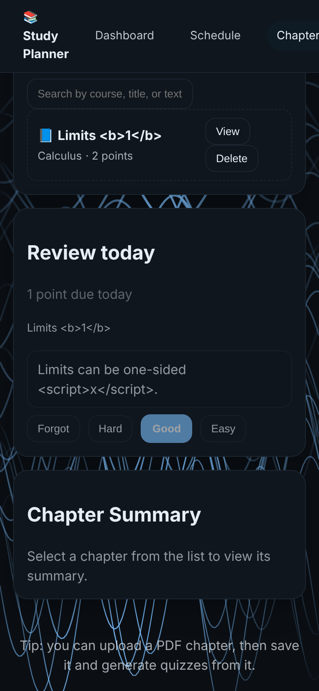

<div align="center">

# 📚 Smart Study

**A study-planning web app that keeps courses, schedules, chapter notes and self-made quizzes in one place.**


</div>

## ✨ What it does

Smart Study helps a student organise a semester:

- 👤 **Accounts**: register and log in; every user only sees their own data (passwords are hashed with `password_hash`).
- 🗂️ **Courses**: create courses with a code and a colour.
- 🗓️ **Weekly schedule**: add classes and study sessions per day and time.
- 📖 **Chapters & notes**: write notes per chapter and keep key points.
- 🤖 **AI summary (optional)**: summarise a chapter's notes with the Gemini API when you provide your own key.
- 📝 **Quizzes from your own notes**: multiple-choice, true/false and fill-in-the-blank questions are generated from your chapter points, with an optional timed *exam mode*. Works with English and Arabic notes.
- 🔁 **Review today (spaced repetition)**: on the Chapters page, the points of your chapters come back as flashcards. After each one you rate it *Forgot / Hard / Good / Easy* and the SM-2 algorithm schedules when you see it again. Progress is stored in this browser (localStorage), not in the database.
- ⚙️ **Settings** saved per user, and an animated background.

## 🧰 Built with

| Layer | Technology |
|---|---|
| Front end | HTML, CSS, vanilla JavaScript (no framework) |
| Back end | PHP 8 with PDO |
| Database | MySQL (tables are created automatically on first run) |
| Tests | Node's built-in test runner, a small PHP test script |

## 🚀 Getting started

**You need:** PHP 8+ with the `pdo_mysql` extension, and a running MySQL server (XAMPP or MAMP both work).

```bash
git clone https://github.com/Zalameri/smart-study.git
cd smart-study
cp env.example env.local      # then edit env.local if your MySQL settings differ
php -S localhost:8000         # run from the project root
```

Open <http://localhost:8000/register.html> and create an account.
The database (`studysplan` by default) and its tables are created automatically.

### Configuration (`env.local`)
The defaults match a typical MAMP setup (`127.0.0.1:8889`, user `root`). Change them in `env.local`, which is git-ignored:

| Setting | Default | Purpose |
|---|---|---|
| `DB_HOST`, `DB_PORT` | `127.0.0.1`, `8889` | MySQL location (XAMPP usually uses port `3306`) |
| `DB_USER`, `DB_PASS`, `DB_NAME` | `root`, `root`, `studysplan` | MySQL login and database |
| `GEMINI_API_KEY` | *(empty)* | Enables the "summarize with AI" button |

> 🔒 Never commit `env.local` or share your API key. Use a dedicated MySQL user instead of `root` if you ever host this online.

## 🧪 Tests

```bash
node --test tests/*.test.js   # quiz logic, SM-2 scheduling, escaping checks
php tests/run.php             # configuration loading and password rules
```

Tests also run automatically on every pull request through GitHub Actions.

## 🗂️ Project structure

```text
smart-study/
├── index.html, login.html, register.html   pages
├── chapters.html, schedule.html, quiz.html
├── assets/
│   ├── app.js, chapters.js, schedule.js    page logic
│   ├── quiz.js, quiz-utils.js              quiz UI and testable quiz generation
│   ├── sm2.js, review.js                   SM-2 scheduling (tested) and the Review today card
│   ├── threads.js, style.css               background animation and styles
├── backend/
│   ├── auth.php, api.php, summarize.php    JSON endpoints
│   ├── db.php, helpers.php                 database setup and shared helpers
├── tests/                                  JavaScript and PHP tests
└── env.example                             configuration template
```

## 🖼️ Screenshots

Review mode on a phone-sized screen (real app UI in headless Chromium, filled with two sample chapter points that include HTML to show it is escaped):



More screenshots have not been added yet.

## 🔭 Ideas for future improvements

- Replace the "delete everything and re-insert" saving in `api.php` with per-item updates.
- Add CSRF protection and restrict the CORS headers to the app's own origin.
- Add server-side validation for schedule times and chapter fields.
- Automated browser tests for the main flows.

## 📝 Notes on this version

Recent maintenance: the project was moved to the repository root, hard-coded database settings moved to configuration, database error details are no longer sent to the browser, sessions are regenerated on login, passwords must be at least 8 characters on registration, and quiz generation now supports Arabic text (it previously froze on it).

## Portfolio

Full case study: <https://zalameri.github.io/project.html?p=smart-study>
